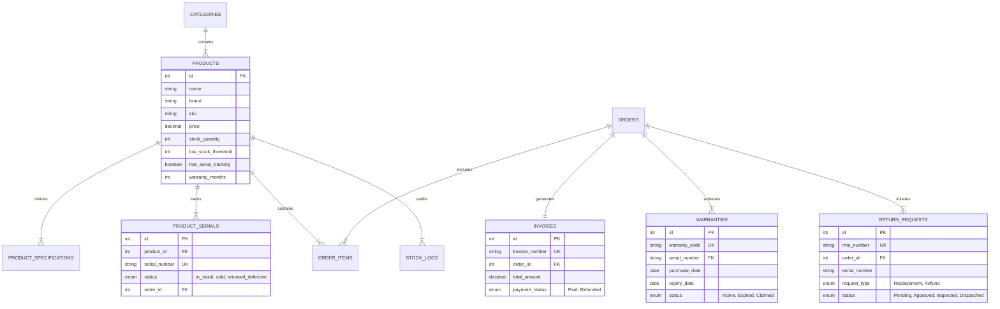

<div align="center">

# ⚡ ElectroPulse — Next-Gen Electronics & Gadget Store

**Enterprise-Grade Electronics Store with Hardware Serial Tracking, Spec Comparison Matrix, Real-time Stock Telemetry, Online Warranty Registry, and RMA Processing.**

[](https://www.php.net/)
[](https://www.mysql.com/)
[](https://developer.mozilla.org/en-US/docs/Web/JavaScript)
[](https://tailwindcss.com/)
[](https://www.chartjs.org/)
[](LICENSE)

<br/>

[Explore Storefront](http://localhost/electronics_store/) • [Compare Gadgets](http://localhost/electronics_store/compare.php) • [Warranty Hub](http://localhost/electronics_store/warranty.php) • [RMA Returns](http://localhost/electronics_store/returns.php) • [Admin Operations](http://localhost/electronics_store/admin.php)

<br/>

```
  ____ _           _             ____        _           
 |  _ | | ___  ___| |_ _ __ ___ |  _ \ _   _| |___  ___  
 | |_) | |/ _ \/ __| __| '__/ _ \| |_) | | | | / __|/ _ \ 
 |  __/| |  __| (__| |_| | | (_) |  __/| |_| | \__ |  __/ 
 |_|   |_|\___|\___|\__|_|  \___/|_|    \__,_|_|___/\___| 
      High-Performance Electronics & Hardware Telemetry
```

</div>

---

## 🚀 Key Highlights & Modules

### 🔍 1. Multi-Device Specification Comparison Engine
- **Side-by-Side Matrix:** Compare up to **4 electronics simultaneously** across granular technical specs (CPU/Chipset, RAM, Storage technology, Screen resolution, Refresh rate, Camera sensors, Battery wattage, Water resistance, Official Warranty).
- **Difference Highlighting:** Interactive **"Highlight Differences"** toggle that dynamically analyzes attributes and highlights contrasting capabilities in green/blue.
- **Persistent Compare Tray:** Floating comparison dock at the bottom of the screen allowing users to collect devices across different categories before launching comparison.

### 📦 2. Stock Tracking & Scarcity Alerts
- **Real-Time Stock Telemetry:** Continuous stock monitoring with automatic low-stock calculation (`stock_quantity <= low_stock_threshold`).
- **Scarcity Ticker Banner:** Real-time homepage alert notifying shoppers when high-demand laptops or smartphones have limited units left.
- **Stock Movement Audit Trail (`stock_logs`):** Immutable log history tracking every purchase deduction, restock intake, defective scrap, or RMA return.
- **Admin Quick-Restock:** One-click modal to restock inventory and generate or allocate new unique hardware serial numbers.

### 🛡️ 3. Hardware Serial Numbers & Warranty Registry
- **Unique Hardware Serials (`product_serials`):** Every high-value phone, laptop, and audio accessory is allocated an authentic manufacturer serial number (e.g. `SN-IP15PM-8831092`) upon checkout.
- **Auto-Warranty Registration:** Warranties activate automatically at order fulfillment with expiry calculated from product warranty duration.
- **Customer Warranty Portal:** Search by Serial Number, Warranty Code, or Order ID to inspect live coverage, days remaining progress bar, or register third-party/retail devices.
- **Printable Certificate:** Official Certificate of Authenticity for warranty validation.

### 🔄 4. Order Returns & Replacement Workflow (RMA)
- **Hassle-Free Customer Filing:** Initiate returns for **Replacement** (new unit dispatch), **Refund** (payment credit), or **Store Credit**.
- **Defect Categorization:** Hardware defect, Display/Audio artifact, Transit damage, Battery issue, Overheating, or Wrong item.
- **4-Stage Visual Lifecycle Tracker:**
  $$\text{1. Submitted} \longrightarrow \text{2. Approved} \longrightarrow \text{3. Inspected} \longrightarrow \text{4. Resolved (Replaced / Refunded)}$$
- **Admin RMA Resolution Manager:** Review RMA tickets, write customer-facing updates, log warehouse technical inspection notes, update serials to `returned_defective`, and issue refunds.

### 📊 5. Sales Analytics & Commercial Tax Invoicing
- **Interactive Analytics Dashboard:** Real-time KPIs for Gross Revenue, Net Revenue, Orders, Average Order Value (AOV), Units Sold, Active Warranties, and Low-stock count.
- **Chart.js Visualizations:**
  - 📈 **Line Chart:** Daily/weekly revenue progression.
  - 🍩 **Donut Chart:** Revenue distribution by gadget category (Smartphones, Laptops, Audio, Wearables, Accessories).
- **Official Commercial Tax Invoices:**
  - Automated invoice generation (`INV-2026-8001`) with GST/Tax ID, itemized totals, and 18% tax breakdown.
  - **Allocated Hardware Serial Numbers printed directly on each line item** as legal proof for warranty claims.
  - QR Code verification and cryptographic SHA-256 invoice hash.
  - One-click clean print / PDF stylesheet formatted for standard paper.

---

## 🏗️ Architecture & Data Model



---

## ⚡ REST API Endpoints

All APIs return standardized JSON responses:

```json
{
  "success": true,
  "message": "Operation completed",
  "data": { ... },
  "timestamp": "2026-10-27T10:00:00Z"
}
```

| Method | Endpoint | Description | Query / Body Parameters |
|:---:|---|---|---|
| `GET` | `/api/products.php` | List products with filters | `category`, `brand`, `min_price`, `max_price`, `sort`, `search` |
| `GET` | `/api/products.php?id={id}` | Get product & specs | `id` or `slug` |
| `GET` | `/api/compare.php` | Side-by-side comparison matrix | `ids=1,2,5` (up to 4 comma-separated product IDs) |
| `POST` | `/api/cart.php` | Cart calculation & tax | `{ items: [{ product_id, quantity }] }` |
| `POST` | `/api/checkout.php` | Place order & allocate serials | `{ customer_name, customer_email, items: [...] }` |
| `GET` | `/api/warranty.php` | Check warranty status | `query={serial_or_warranty_or_order}` |
| `POST` | `/api/warranty.php` | Self-register device warranty | `{ serial_number, product_id, customer_name, ... }` |
| `GET` | `/api/returns.php` | Track RMA ticket status | `rma={rma_number}` or `order={order_number}` |
| `POST` | `/api/returns.php` | Submit new RMA claim | `{ order_number, customer_email, reason, request_type }` |
| `POST` | `/api/returns.php?action=update_status` | Admin updates RMA | `{ id, status, admin_response, resolution_notes }` |
| `GET` | `/api/stock.php` | Stock levels & low-stock alerts | (None) |
| `POST` | `/api/stock.php?action=restock` | Restock intake & serials | `{ product_id, quantity, serials, note }` |
| `GET` | `/api/analytics.php` | Executive sales analytics & charts | (None) |
| `GET` | `/api/invoices.php` | Invoices list & details | `id`, `number`, `search`, `status` |

---

## 🧪 Quick Test Sandbox (Demo Data)

Test the live system immediately with these pre-seeded demo records:

### 📱 Sample Device Serials (Warranty Check)
| Device | Serial Number | Status |
|---|---|---|
| **Apple iPhone 15 Pro Max (Titanium Blue)** | `SN-IP15PM-8831092` | Active (12 Months Official Apple Coverage) |
| **Samsung Galaxy S24 Ultra (512GB)** | `SN-S24U-9942001` | Active (Samsung Care+ 24 Months Coverage) |
| **MacBook Pro 16" M3 Max (36GB / 1TB)** | `SN-MBP16-3390111` | Active (AppleCare+ Enterprise Protection) |
| **Sony WH-1000XM5 ANC Headphones** | `SN-XM5-551101` | Claimed (RMA replacement currently in progress) |

### 🔄 Active RMA Return Tickets
| RMA Code | Order Ref | Status | Reason |
|---|---|---|---|
| `RMA-2026-0041` | `ORD-2026-1001` | **Approved - Ship Item Back** | Audio static defect in ANC mode |
| `RMA-2026-0042` | `ORD-2026-1002` | **Pending Review** | Packaging damaged during transit |

### 🧾 Sample Commercial Tax Invoices
| Invoice Number | Order Ref | Customer | Total Amount |
|---|---|---|---|
| `INV-2026-8001` | `ORD-2026-1001` | Alexander Vance | $1,766.46 |
| `INV-2026-8002` | `ORD-2026-1002` | Elena Rostova | $1,453.42 |
| `INV-2026-8003` | `ORD-2026-1003` | Marcus Sterling | $3,951.82 |

---

## 💻 Installation & Setup Guide

### 1. Requirements
- **Web Server:** Apache (via XAMPP, WAMP, or standalone)
- **PHP:** 8.0 or newer (with `pdo_mysql` extension enabled)
- **Database:** MySQL 8.0+

### 2. Clone the Repository
```bash
git clone https://github.com/jiya-08/electronics_store.git C:/xampp/htdocs/electronics_store
```

### 3. Database Setup (One-Click)
1. Start **Apache** and **MySQL** in the XAMPP Control Panel.
2. Open your browser and navigate to:
   ```
   http://localhost/electronics_store/install.php
   ```
3. Click **"Install & Seed Electronics Store Database"**.
4. The script will automatically create `electronics_store_db`, configure the 10 tables, and seed all products, specifications, and demo orders.

### 4. Explore the Application
- **Storefront:** [http://localhost/electronics_store/](http://localhost/electronics_store/)
- **Catalog & Specs:** [http://localhost/electronics_store/products.php](http://localhost/electronics_store/products.php)
- **Comparison Engine:** [http://localhost/electronics_store/compare.php?ids=1,2](http://localhost/electronics_store/compare.php?ids=1,2)
- **Warranty Center:** [http://localhost/electronics_store/warranty.php](http://localhost/electronics_store/warranty.php)
- **RMA Returns:** [http://localhost/electronics_store/returns.php](http://localhost/electronics_store/returns.php)
- **Admin Operations:** [http://localhost/electronics_store/admin.php](http://localhost/electronics_store/admin.php)

---

## 📂 Project Directory Structure

```
electronics_store/
├── api/                   # RESTful JSON APIs
│   ├── analytics.php      # Sales analytics & Chart.js data
│   ├── cart.php           # Cart calculation & tax engine
│   ├── checkout.php       # Transaction-safe checkout & serial allocation
│   ├── compare.php        # Hardware comparison matrix with diff analyzer
│   ├── invoices.php       # Invoices query & item details
│   ├── products.php       # Product catalog, search & spec fetcher
│   ├── returns.php        # RMA filing, lifecycle tracking & updates
│   ├── stock.php          # Stock telemetry & warehouse restock intake
│   └── warranty.php       # Warranty verification & registration
├── assets/
│   ├── css/style.css      # Custom styling, RMA timeline, badges, compare tray
│   └── js/app.js          # Cart management, compare tray, toast notifications
├── config/
│   ├── config.php         # Global constants, tax rates & store details
│   └── database.php       # PDO connection & standardized JSON helpers
├── database/
│   ├── schema.sql         # Relational database schema
│   └── seed.sql           # Seed data: flagship phones, M3 laptops, serials, orders
├── includes/
│   ├── header.php         # Sticky modern navbar with live badges
│   └── footer.php         # Footer with compare tray & toast notifications
├── index.php              # Homepage with hero, deals & scarcity ticker
├── products.php           # Catalog with multi-facet filters & live search
├── product-detail.php     # Deep specifications table & warranty guarantee
├── compare.php            # Multi-gadget side-by-side comparison matrix
├── cart.php               # Shopping cart & checkout simulator
├── warranty.php           # Warranty lookup & self-registration hub
├── returns.php            # RMA returns & 4-stage visual progress tracker
├── invoice.php            # Printable electronic tax invoice with serials & QR
├── admin.php              # Operations dashboard: Analytics, Stock, RMA & Invoices
├── install.php            # One-click automated database installer
└── README.md              # Project documentation
```

---

<div align="center">
  <sub>Built with ❤️ by Jiya | Powered by PHP, MySQL, JavaScript & REST APIs</sub>
</div>
